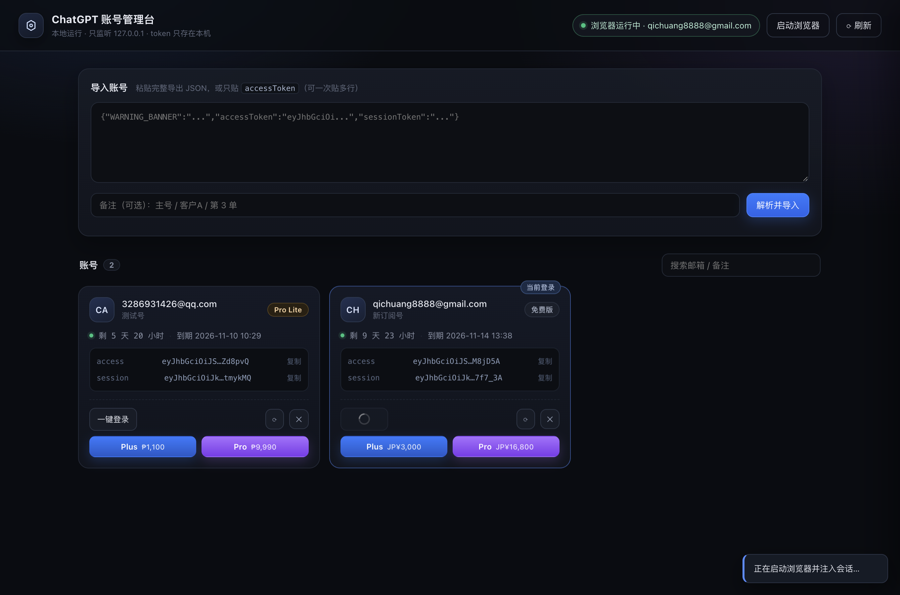
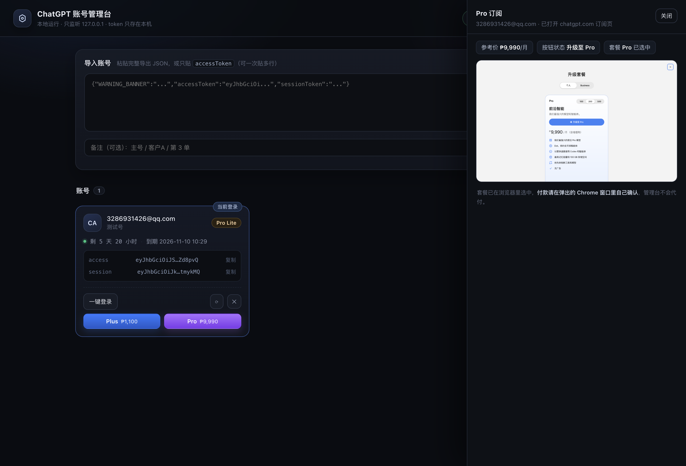
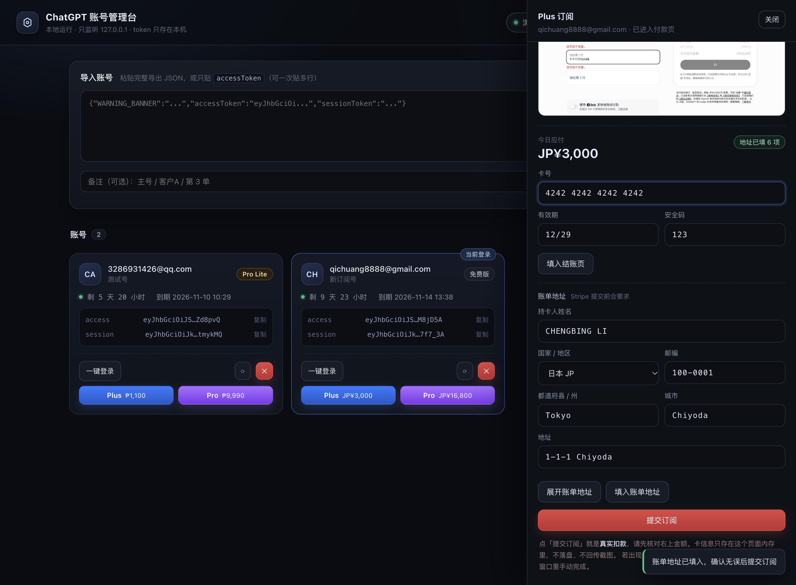

# ChatGPT 账号管理台

本地运行的 ChatGPT 账号管理端：粘贴 token 导出 → 校验 → 列表管理 → 一键登录浏览器 → 打开 Plus / Pro 订阅（套餐自动选中）→ 进 Stripe 结账页 → 填卡/账单地址 → 提交订阅。

只监听 `127.0.0.1`，token 只存在本机。



## 快速开始

```bash
cd /Users/shengye/pojects/gpt-buy
./start.sh          # 或者：python3 admin_server.py --port 8899
```

然后打开 <http://127.0.0.1:8899>。

## 功能

| 功能 | 说明 |
|---|---|
| 导入账号 | 粘贴完整导出 JSON（`accessToken` + `sessionToken`），或只贴 `accessToken`；支持一次贴多个 |
| 校验 | 调 `chatgpt.com/backend-api/me` 验证 accessToken，解 JWT 取套餐 / 邮箱 / 过期时间 |
| 列表 | 邮箱、备注、套餐徽章、token 剩余时间、有效状态，支持搜索 |
| 复制 | 一键复制 accessToken / sessionToken（本地接口，不出网） |
| 一键登录 | 把 sessionToken 注入独立 Chrome 配置并打开 chatgpt.com，页面直接是登录态 |
| Plus / Pro | 打开 `/pricing` 取真实 CTA 链接（带 `highlight_plan=plus\|pro`），进订阅弹窗后自动选中对应套餐，回传价格 + 截图 |
| 去结账 | 在同一窗口点「立即购买 / 升级至」，停在 Stripe 结账页，读出「今日应付」金额 |
| 填卡 | 卡号 / 有效期 / CVC 可直接在管理台填写，写入 Stripe 子 frame 并回读校验 |
| 账单地址 | Stripe 提交前要求地址；「展开账单地址」触发表单校验后，填姓名/国家/邮编/都道府县/城市/地址 |
| 提交订阅 | 红色按钮 + 金额确认框，点下去就是真实扣款；结果文本会回传 |
| 刷新校验 | 单账号重新验活，失效会被标红 |



## 目录结构

```
admin_server.py     HTTP 服务 + 账号存储 + API（标准库 http.server）
cgpt.py             CDP 控制、cookie 分块注入、订阅弹窗定位、截图
login_chatgpt.py    命令行版：只做“登录并打开窗口”
web/index.html      管理台页面
web/style.css       样式
web/app.js          前端逻辑
data/accounts.json  账号数据（0600，含明文 token）
data/shots/         Plus/Pro 订阅页截图
.chrome-gpt-profile 独立 Chrome 配置（不动日常浏览器）
```

## API

| 方法 | 路径 | 说明 |
|---|---|---|
| GET | `/api/status` | 浏览器 / 当前登录账号状态 |
| GET | `/api/accounts` | 账号列表（token 已打码） |
| POST | `/api/accounts` | 导入，body: `{raw, alias}` |
| POST | `/api/accounts/{id}/login` | 注入会话并打开已登录窗口 |
| POST | `/api/accounts/{id}/plan` | body: `{plan:"plus"\|"pro"}`，打开订阅弹窗并选中 |
| POST | `/api/accounts/{id}/checkout` | body: `{plan}`，点购买并停在 Stripe 结账页，返回金额/是否就绪 |
| POST | `/api/accounts/{id}/card` | body: `{number, exp, cvc}`，写入 Stripe 卡信息框 |
| POST | `/api/accounts/{id}/reveal` | 点一次「订阅」展开账单地址区块（不扣款） |
| POST | `/api/accounts/{id}/address` | body: `{name, country, postal, state, city, line1}`，写账单地址 |
| POST | `/api/accounts/{id}/subscribe` | body: `{confirm:true}`，点「订阅」提交，返回结果文本 |
| POST | `/api/accounts/{id}/check` | 重新校验 token |
| GET | `/api/accounts/{id}/token?type=access\|session` | 取完整 token（供复制） |
| DELETE | `/api/accounts/{id}` | 删除本地记录 |
| POST | `/api/browser/start` | 启动独立 Chrome |

## 完整购买链路

```
选 Plus/Pro  →  订阅弹窗（套餐已选中）  →  立即购买
      →  /checkout/... Stripe 结账页（今日应付金额）
      →  填卡（number / expiry / cvc）
      →  展开账单地址（点一次订阅触发表单校验，不会扣款）
      →  填地址（姓名/国家/邮编/都道府县/城市/地址）
      →  提交订阅（真实扣款，需二次确认）
```



## 实现要点（踩过的坑）

1. **sessionToken 超过 4096 字节**：Chrome 单 cookie 上限，直接 `Network.setCookie` 会报
   `Sanitizing cookie failed`。必须按 NextAuth 规则分块成
   `__Secure-next-auth.session-token.0 / .1`，服务端会自动拼回。
2. **Chrome 在沙箱内必须 `--no-sandbox`**：否则渲染进程崩溃，调试端口起不来。
3. **`/api/auth/session` 才是登录态判据**：`/backend-api/me` 带 cookie 访问会返回匿名 `ua-...`，
   容易误判成未登录。
4. **`highlight_plan` 参数来自定价页 CTA**：不要手写，每次从 `/pricing` 页读真实 `href`
   （里面还有随机 `ifpazk` 和当前语言前缀）。
5. **无头模式会被 Cloudflare 拦**（页面停在“请稍候…”），所以永远用有头窗口。
6. **卡信息在跨域 iframe 里**：`js.stripe.com` 的 `elements-inner-*` 是独立 target，
   要用 `Target` 级别的 CDP 连接 + `Input.insertText` 逐字段输入，Stripe 才会做卡号格式化。
7. **账单地址是第二个同类 frame**：只有点过「订阅」才会出现，且改国家会重渲染整块表单，
   所以必须“先选国家 → 再填其余字段”，州/省要从下拉 option 里匹配（如 `Tokyo`）。
8. **提交后地址缺失不会扣款**：Stripe 先做表单校验，地址补齐后再点才会真正发起扣款。

## 安全

- 服务只绑定 `127.0.0.1`，不要改成 `0.0.0.0` 上公网。
- `data/accounts.json` 里是**明文 token**（等同密码），权限 0600，不要提交到 git、不要同步网盘。
- 卡号/CVC **只在浏览器内存里**：从管理台输入框发出后直接写进 Stripe iframe，
  不写 `data/accounts.json`、不写日志、不落截图（截图都在填卡之前拍）。
- **「提交订阅」是真实扣款**：按钮前有金额确认框，后端还要求 `confirm:true`，默认不会自动点。
- 一次只能登录一个账号（cookie 是 profile 级的），切号会自动重写会话。
- token 被踢下线时，重新从浏览器导出 `chatgpt.com/api/auth/session` 的 JSON 再导入即可覆盖。
