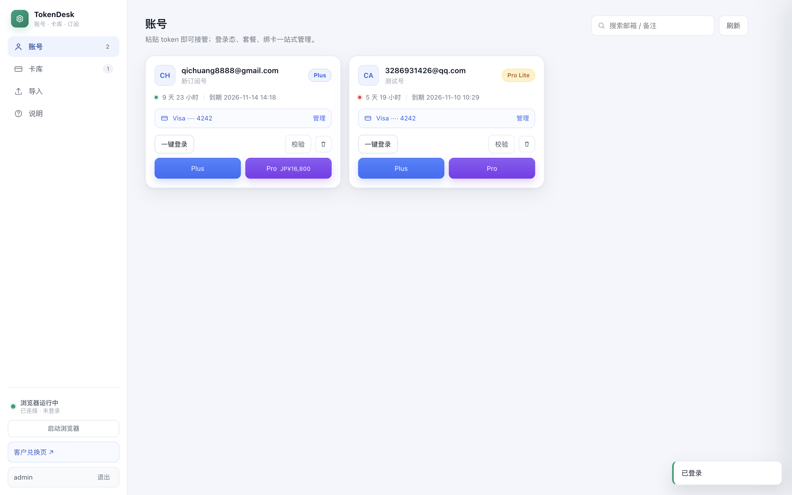
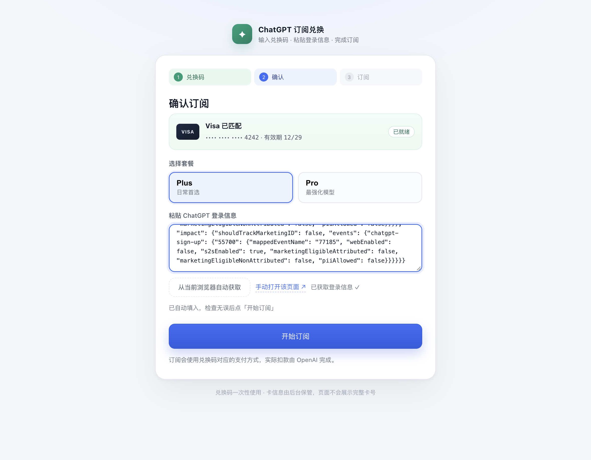
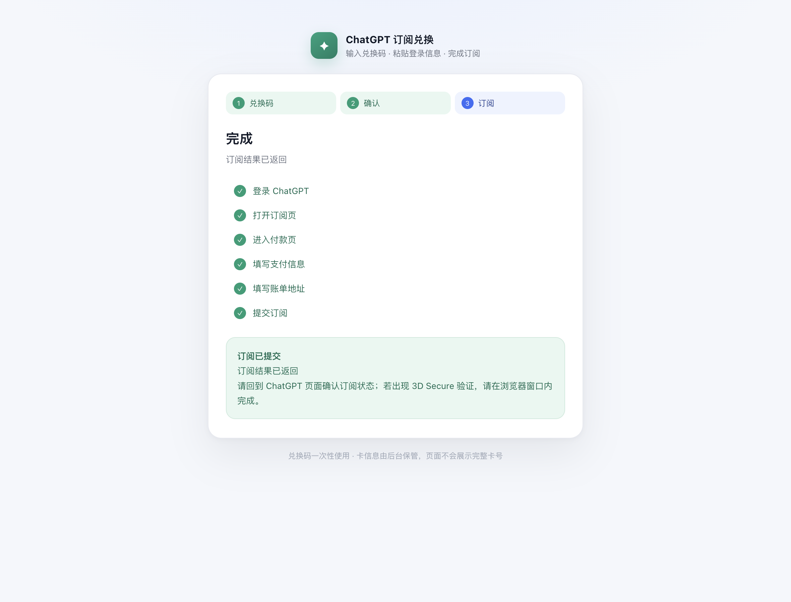

# TokenDesk

**自助充值地址：<https://chat-ai.51aihelp.com>**


ChatGPT 订阅自动化工具，分两套完全隔离的页面：

| 端口 | 页面 | 主题 | 登录 | 使用者 |
|---|---|---|---|---|
| `8899` | 管理后台 `/` | 浅色 | admin / 密码（见下） | 你自己：管账号、管卡、发兑换码 |
| `8900` | 客户兑换页 `/` | 浅色 | 兑换码 | 客户：输兑换码 → 贴登录信息 → 一键订阅 |

### 管理端登录

首次启动自动生成密码，写入 `data/初始密码.txt`，同时后台日志会打印一行。
也可以自己指定：

```bash
ADMIN_USER=admin ADMIN_PASSWORD=你的密码 python3 admin_server.py --port 8899
```

改密码：删掉 `data/auth.json` 重启（会重新生成），或直接用上面的环境变量。
密码用 PBKDF2-SHA256（12 万次）加盐存储，会话是 HttpOnly Cookie，12 小时过期，
并持久化在 `data/sessions.json`（0600）——**重启服务不用重新登录**。



## 客户流程（亮色 / 独立端口）

1. 客户打开 `http://<host>:8900`
2. 输入兑换码 → 命中对应卡（只显示 `Visa ···· 4242`，客户看不到完整卡号）
3. 选 Plus / Pro
4. 点「从当前浏览器自动获取」——后台会用受控 Chrome 打开 `chatgpt.com/api/auth/session`，把 JSON 读回来自动填入（也可以点旁边的手动链接自己复制）
5. 点「开始订阅」，后台自动完成：登录 → 打开订阅页 → 进付款页 → 填卡 → 填账单地址 → 提交




## 后台卡库与兑换码

- 每张卡自动生成一个兑换码（`AB3K-9PQD-M2` 形式），可复制、可重置（重置后旧码立即失效）
- **一张卡可以绑定多个账号**（卡库里用 chips 展示，勾选框增删）
- 卡行有「复制卡」按钮，一次复制 `卡号 / 有效期 / CVC`，可直接粘到支付表单
- 客户页只按兑换码取卡，不暴露账号
- 兑换成功后标记「已兑换」，状态留在卡库里

## 代理 IP（动态住宅，每单一个新 IP）

后台侧边栏「代理」管理多个**渠道**，选一个为**默认渠道**（也可选「直连」）：

```
Chrome → 127.0.0.1:<槽位端口>（本地中继）→ 默认渠道（kookeey 网关 / 自定义上游）→ 目标
         管理端浏览器 8898；客户池 c0 / c1 … 用 8960 / 8961 …
```

- **每次启动浏览器签一份租约**：默认渠道 + 新的 8 位 session ⇒ 一个新的动态住宅 IP。
  客户每笔开通都会新开浏览器，所以**每单一个新 IP，单内 IP 不变**（结账需要 IP 一致）。任务结束杀浏览器时释放租约。
- 渠道类型
  - **kookeey 动态住宅**（提取模式 · 账密）：用户 ID、提取账号/密码、地区（`US` / `JP` / `US_California` / `global`）、网关。
    连接串按官方格式拼：`用户ID-账号:密码-地区-session@gate.kookeey.info:1000`。
    填了**开发者 token** 后可调 `chgsessionip` 接口换 IP、查动态套餐余量（`/package`）、一键拉取提取账密（`/resauth`）。
  - **自定义上游**：`http(s)://` / `socks5://` / `host:port:user:pass`；`{session}` 占位符会替换成随机 session；可选「换 IP 链接」（GET）。
- 换 IP 方式：「每个任务一个 IP」（默认）或「每个连接都换 IP」（同一结账会出现多个 IP，只建议测试用）。
- **切换 IP**：kookeey 有 token 时调接口给当前 session 换出口，失败或没 token 就换新 session；
  中继随后断开该浏览器的旧连接，浏览器重连即走新 IP，不用重启。改了默认渠道后点「切换 IP」也会立即切过去。
- 「在用的出口」列出每个浏览器当前的渠道 / session / 出口 IP；兑换记录里也记下每单的出口（只给后台看，不回给客户页）。
- 密码、token、上游地址加密落盘（`data/proxy.json`），租约在 `data/proxy_leases/`。旧版 `{"upstream": ...}` 自动变成「旧配置」渠道。
- `127.0.0.1` 走 `--proxy-bypass-list` 直连，不会被代理。

```bash
python3 proxy_relay.py --port 8898      # 手动起中继（start.sh 会自动起）；升级后需重启中继
```

> 币种由 IP 区域 + 账号账单地区共同决定；换 IP 后要重新打开订阅页才会刷新价格。
> 卡国家与 IP 差异过大时 Stripe 可能直接拒付。

**实测记录（2026-11）**：`gate.kookeey.info:1000` 香港节点可以连通（HTTP 515ms / SOCKS5 435ms，
出口 119.236.157.37），但访问 chatgpt.com 被直接拦截：

```
Unable to load site
Please try again later. If you are using a VPN, try turning it off.
[IP:119.236.157.37]
```

结论：机房 IP 会被 ChatGPT 识别为 VPN。要拿地区价，需要住宅/移动出口，且最好与账号账单地区一致。

## 启动

```bash
python3 proxy_relay.py --port 8898      # 代理中继（可选，start.sh 会起）
python3 admin_server.py --port 8899     # 后台
python3 customer_server.py --port 8900  # 客户页
```

## 代码结构（单文件均 < 500 行）

```
cgpt/                  # 自动化核心（原 cgpt.py 拆分）
  config.py            常量
  cdp.py               CDP 连接 / 浏览器进程 / 截图
  auth.py              token 解析、cookie 分块注入、登录
  plans.py             定价页、套餐弹窗、结账页跳转
  cards.py             Stripe 卡信息与账单地址填写
store.py               账号 / 卡库 / 兑换码 持久化（含原子写 JSON 工具）
browser.py             共享 Chrome 单例 / 浏览器池（每个实例一个代理槽位）
proxyhub/              代理 IP 模块：渠道、默认渠道、租约、kookeey API、出口探测
proxy_relay.py         本地代理中继（按槽位端口选上游，换 IP 时断开旧连接）
admin_proxy.py         后台「代理」接口
httpbase.py            两个服务共用的 HTTP 基类（JSON 响应、请求体、静态文件）
admin_server.py        后台 API + 静态服务（629 行）
customer_server.py     客户页 API + 订阅任务队列（311 行）
web/                   后台前端（深色）
web_customer/          客户前端（浅色）
```

## 已知边界

- 提交后按页面文案判断结果（成功/被拒/待验证），Stripe 的 3DS 仍需人工在窗口完成
- 客户页与后台共享同一个 Chrome 配置，同一时刻只能处理一个订阅任务（有队列锁）
- 后台前端 `web/app.js` 812 行、`style.css` 610 行，仍可继续按视图拆分
